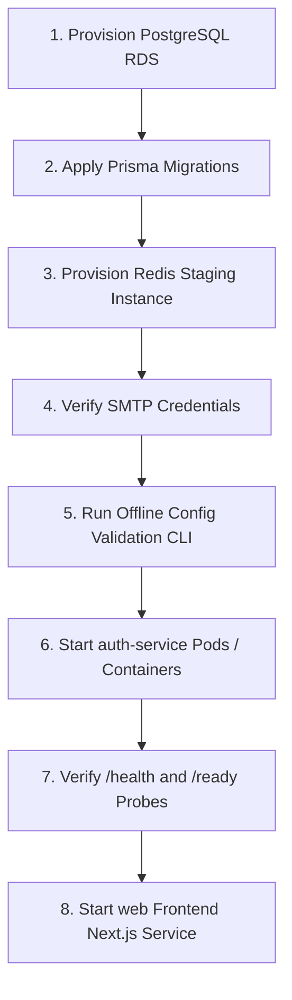
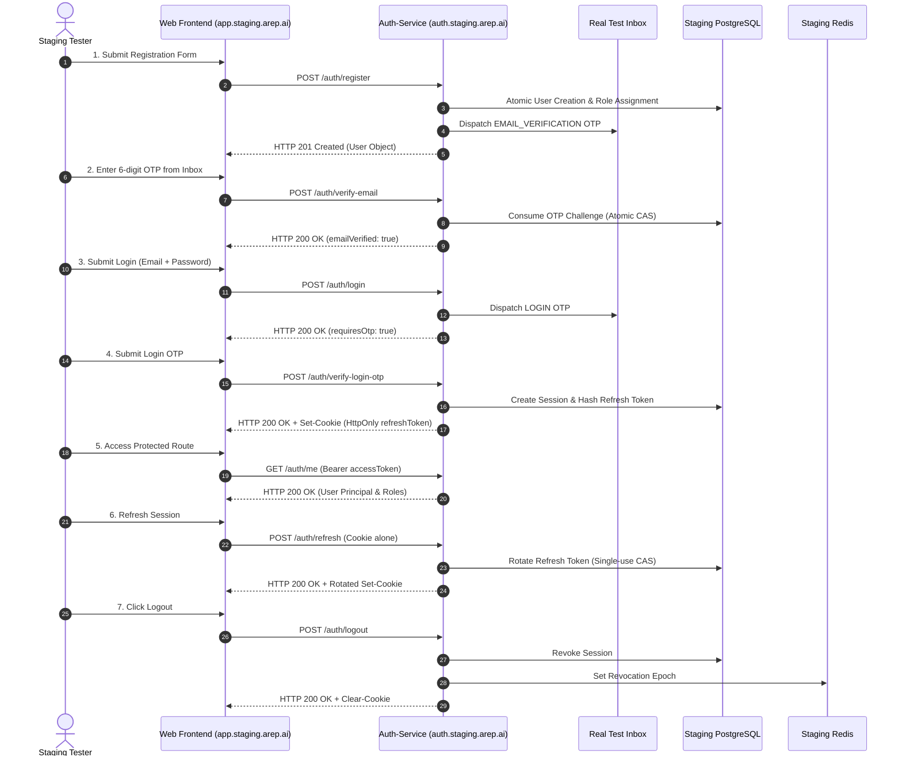

# AREP Member 1: Authentication Service Staging Integration Handoff & Safe Environment Readiness Runbook

This document serves as the official integration handoff and operational readiness runbook for the AREP `auth-service` and its integration with the `web` frontend. It defines the exact environment configuration, secret management standards, infrastructure prerequisites, deployment sequencing, end-to-end smoke tests, and objective acceptance gates for staging integration.

---

## 1. Safety Posture & Verification Status Legend

### Safe Environment Rules
1. **Zero Deployment / Offline-First**: No live deployment has been executed in this handoff phase. No real infrastructure (PostgreSQL port 5432, remote Redis, or production SMTP relays) has been contacted.
2. **Zero Real Secrets**: All examples in this document and repository templates use non-secret placeholders. Real production credentials must never be committed to source control or printed in unmasked logs.
3. **Dedicated Staging Infrastructure**: PostgreSQL migrations and staging workloads must run against dedicated staging databases (e.g. AWS RDS or an isolated Docker port such as 5433), **never against host port 5432** which is reserved for host services.

### Verification Categories
Every step, check, and capability in this runbook is explicitly tagged with one of three confidence tiers:
- `[ALREADY TESTED]`: Proven passing in automated offline unit, integration, and HTTP boundary test suites (439 tests in `auth-service`, 26 tests in `web`).
- `[CODE-VALIDATED ONLY]`: Fully implemented and validated via offline parsers, CLI tools, or mock abstractions, but has not yet run against live distributed infrastructure.
- `[REQUIRES LIVE STAGING VERIFICATION]`: Inherently requires live staging infrastructure (real network sockets, external SMTP inboxes, cross-domain browser cookies, TLS-terminating proxies) to confirm end-to-end functionality.

---

## 2. Configuration & Service Consumption Matrix

The table below catalogs every environment variable, identifies which service consumes it, outlines validation constraints enforced by `parseAuthConfig()`, and states the current verification status.

| Variable | Consuming Service | Staging Requirement (`NODE_ENV=production`) | Validation Constraints & Rules | Verification Status |
| :--- | :--- | :--- | :--- | :--- |
| `NODE_ENV` | `auth-service` | `production` | Must be one of `development`, `test`, `production`. Activates strict validation. | `[ALREADY TESTED]` |
| `HOST` | `auth-service` | `0.0.0.0` | Bind host. Must not contain whitespace. `0.0.0.0` required for containers/Kubernetes. | `[ALREADY TESTED]` |
| `PORT` | `auth-service` | `3001` (or orchestrator port) | Integer between 1 and 65535. | `[ALREADY TESTED]` |
| `APP_BASE_URL` | `auth-service` | `https://auth.staging.arep.ai` | Canonical service URL. **MUST use `https://` in production.** Rejects credentials and HTTP. | `[ALREADY TESTED]` |
| `TRUST_PROXY` | `auth-service` | `true` | Strict boolean (`true`/`false`). Enables inspection of upstream `X-Forwarded-For`. | `[ALREADY TESTED]` |
| `CORS_ALLOWED_ORIGINS` | `auth-service` | `https://app.staging.arep.ai` | Comma-separated list of exact HTTPS browser origins. Wildcards (`*`) and `localhost` strictly forbidden. | `[ALREADY TESTED]` |
| `DATABASE_ENABLED` | `auth-service` | `true` | Strict boolean. Must be `true` in staging/production (in-memory mode forbidden). | `[ALREADY TESTED]` |
| `DATABASE_URL` | `auth-service` & Prisma CLI | `postgresql://<user>:<pass>@<host>:<port>/<db>?sslmode=require` | Valid PostgreSQL URL. Cannot contain dev placeholder passwords (`arep_dev_only`). | `[ALREADY TESTED]` (parser) / `[REQUIRES LIVE STAGING VERIFICATION]` (staging RDS) |
| `REDIS_ENABLED` | `auth-service` | `true` | Strict boolean. Must be `true` in staging/production for distributed revocation cache. | `[ALREADY TESTED]` |
| `REDIS_HOST` | `auth-service` | `staging-redis.internal` | Required when `REDIS_ENABLED=true`. Hostname or IP. | `[ALREADY TESTED]` |
| `REDIS_PORT` | `auth-service` | `6379` | Integer between 1 and 65535. | `[ALREADY TESTED]` |
| `REDIS_PASSWORD` | `auth-service` | Strong secret via Secret Manager | Required in production. Cannot use placeholder passwords (`arep_redis_dev_only`, `<...>`). | `[ALREADY TESTED]` (parser) / `[REQUIRES LIVE STAGING VERIFICATION]` (staging Redis) |
| `OTP_HMAC_SECRET` | `auth-service` | 64-char hex string | Minimum 32 characters, high entropy. Rejects dictionary words and dev defaults. | `[ALREADY TESTED]` |
| `OTP_TTL_SECONDS` | `auth-service` | `600` (10 minutes) | Challenge lifespan in seconds. Positive integer. | `[ALREADY TESTED]` |
| `OTP_MAX_ATTEMPTS` | `auth-service` | `5` | Maximum failed verifications before challenge lockout. Positive integer. | `[ALREADY TESTED]` |
| `SESSION_REFRESH_TOKEN_TTL_DAYS` | `auth-service` | `7` | Refresh token and session lifespan in database and HttpOnly cookie. Positive integer. | `[ALREADY TESTED]` |
| `JWT_SECRET` | `auth-service` | 64-char hex string | Minimum 32 characters, high entropy. Rejects dictionary words and dev defaults. | `[ALREADY TESTED]` |
| `JWT_EXPIRES_IN_SECONDS` | `auth-service` | `900` (15 minutes) | Access token lifespan in seconds. Positive integer. | `[ALREADY TESTED]` |
| `JWT_ISSUER` | `auth-service` | `arep-auth-service` | JWT `iss` claim. Must match across issued and verified tokens. | `[ALREADY TESTED]` |
| `JWT_AUDIENCE` | `auth-service` | `arep-api` | JWT `aud` claim. Must match across issued and verified tokens. | `[ALREADY TESTED]` |
| `SMTP_ENABLED` | `auth-service` | `true` | When true, enables real email dispatch for verification and login OTPs. | `[ALREADY TESTED]` |
| `SMTP_AUTH_REQUIRED` | `auth-service` | `true` | When true, requires `SMTP_USERNAME` and `SMTP_PASSWORD`. | `[ALREADY TESTED]` |
| `SMTP_HOST` | `auth-service` | `email-smtp.<region>.amazonaws.com` | SMTP gateway host. | `[CODE-VALIDATED ONLY]` |
| `SMTP_PORT` | `auth-service` | `465` (or `587`) | SMTP port. 465 uses implicit TLS; 587 uses STARTTLS. | `[CODE-VALIDATED ONLY]` |
| `SMTP_SECURE` | `auth-service` | `true` (for 465) / `false` (for 587) | Boolean controlling implicit TLS socket upgrade. | `[CODE-VALIDATED ONLY]` |
| `SMTP_USERNAME` | `auth-service` | Staging SMTP user | Required when `SMTP_AUTH_REQUIRED=true`. | `[CODE-VALIDATED ONLY]` |
| `SMTP_PASSWORD` | `auth-service` | Staging SMTP password | Required when `SMTP_AUTH_REQUIRED=true`. Values redacted from logs. | `[CODE-VALIDATED ONLY]` |
| `SMTP_FROM` | `auth-service` | `AREP Staging <noreply@staging.arep.ai>` | Verified sender envelope and display address. | `[CODE-VALIDATED ONLY]` |
| `SMTP_TIMEOUT_MS` | `auth-service` | `5000` | Socket timeout for SMTP dispatch. Defaults to 5000ms. | `[ALREADY TESTED]` |
| `NEXT_PUBLIC_AUTH_API_URL` | `apps/web` (Frontend) | `https://auth.staging.arep.ai` | Public HTTPS base URL used by browser client to reach `auth-service`. | `[ALREADY TESTED]` (client) / `[REQUIRES LIVE STAGING VERIFICATION]` (staging domain) |

---

## 3. Cryptographic Secrets & Key Management

### Generation Standards
All cryptographic secrets must be generated using an operating-system cryptographically secure pseudorandom number generator (CSPRNG):

```bash
# Generate 256-bit (64 hex character) OTP HMAC secret
openssl rand -hex 32

# Generate 256-bit (64 hex character) JWT signing secret
openssl rand -hex 32

# Generate Redis authentication password
openssl rand -base64 32
```

### Storage and Injection Requirements
- **Zero Plaintext Files**: Secrets must **never** be committed to Git or stored in unencrypted `.env` files on staging servers.
- **Secret Manager Provider**: Inject variables into staging container runtimes via:
  - AWS Secrets Manager / Parameter Store (ECS / EKS task definitions)
  - Kubernetes Secrets (sealed secrets or external-secrets operator)
  - HashiCorp Vault
- **Pre-Flight Validation**: Prior to starting the service, run `pnpm auth:validate-config` in CI/CD pipeline step to ensure variables adhere to production requirements without exposing values.

### Secret Rotation Procedures
1. **`JWT_SECRET` Rotation**:
   - The current implementation uses single active symmetric key verification (`HS256`).
   - Rotating `JWT_SECRET` invalidates all existing in-flight access tokens immediately.
   - *Impact*: Low disruption. Because browser clients maintain active sessions via HttpOnly cookies, browser clients will transparently refresh and receive new access tokens on their next API call. Native clients will refresh on their next cycle.
2. **`OTP_HMAC_SECRET` Rotation**:
   - Rotating `OTP_HMAC_SECRET` invalidates pending unconsumed OTP challenges (state remains pending, but HMAC verification will fail).
   - *Impact*: Low disruption. Users attempting verification will receive HTTP 400 (`Invalid or expired verification code`) and can immediately request a new OTP code.
3. **Database & Redis Credential Rotation**:
   - Execute a coordinated rolling update: provision new credentials on the database/cache server, update the secret manager, and execute a rolling restart of the `auth-service` pods.

---

## 4. Staging Infrastructure Provisioning & Verification

### A. PostgreSQL Provisioning & Schema Migration
- **Instance Sizing**: Dedicated PostgreSQL 15+ RDS/Aurora instance with TLS enabled (`sslmode=require`).
- **Connection String**: `DATABASE_URL=postgresql://<user>:<password>@<staging-db-host>:5432/<staging-db-name>?sslmode=require`
- **Safety Restriction**: Do **NOT** target port 5432 on localhost during development or testing.
- **Migration Commands**:
  ```bash
  # Check status of applied migrations against staging DB (read-only)
  DATABASE_URL="<STAGING_DATABASE_URL>" pnpm --filter auth-service prisma migrate status

  # Apply pending migrations safely without schema reset
  DATABASE_URL="<STAGING_DATABASE_URL>" pnpm --filter auth-service prisma migrate deploy
  ```
- **Migration Baseline Verification**:
  - Migration file: `services/auth-service/prisma/migrations/20261011171906_init_auth_schema/migration.sql`
  - Creates 7 tables: `users`, `external_identities`, `roles`, `user_roles`, `otp_challenges`, `auth_sessions`, `password_history`, `security_events`.
  - Creates 4 PostgreSQL ENUMs: `AccountStatus`, `OtpPurpose`, `OtpState`, `SecurityEventType`.
- **Status**: Migration SQL matches Prisma schema exactly `[ALREADY TESTED]`; migration application against live staging DB `[REQUIRES LIVE STAGING VERIFICATION]`.

### B. Redis Provisioning & Connectivity
- **Role**: Distributed session revocation tracking (`auth:revocation:user:<userId>`, `auth:revocation:session:<sessionId>`), user state caching, and IP rate limiting.
- **Connectivity Check**:
  ```bash
  # Test connectivity and authentication from staging bastion or container
  redis-cli -h <STAGING_REDIS_HOST> -p 6379 -a <STAGING_REDIS_PASSWORD> ping
  # Expected response: PONG
  ```
- **Fail-Closed Verification**:
  - If Redis becomes unreachable during token revocation lookup, `TokenService.isTokenRevoked()` intentionally fails closed by throwing `ServiceUnavailableException` (HTTP 503 Service Unavailable) rather than assuming tokens are valid or incorrectly returning 401. This prevents bypass of revocations while properly indicating an infrastructure outage to upstream clients.
- **Status**: Fail-closed logic and multi-instance revocation tested `[ALREADY TESTED]`; staging cluster connectivity `[REQUIRES LIVE STAGING VERIFICATION]`.

### C. SMTP Setup & Email Delivery
- **Provider**: Amazon SES, SendGrid, or dedicated Mailgun staging domain.
- **Configuration**:
  - Port 465 (implicit TLS: `SMTP_PORT=465`, `SMTP_SECURE=true`) OR Port 587 (STARTTLS: `SMTP_PORT=587`, `SMTP_SECURE=false`).
  - `SMTP_AUTH_REQUIRED=true` with valid staging SMTP credentials.
  - `SMTP_FROM="AREP Staging <noreply@staging.arep.ai>"` (must be a verified identity in the email service).
- **Failure Isolation**:
  - If email delivery fails, the transaction is cleanly aborted; no phantom accounts or false success messages are presented.
- **Status**: Error isolation and delivery failure handling tested `[ALREADY TESTED]`; real inbox delivery `[REQUIRES LIVE STAGING VERIFICATION]`.

### D. HTTPS Ingress, CORS, Cookies & Reverse Proxy
- **TLS Termination**: Ingress / Load Balancer (AWS ALB, Cloudflare, NGINX) must terminate HTTPS with valid staging TLS certificates for both `auth.staging.arep.ai` and `app.staging.arep.ai`.
- **Trusted Proxy (`TRUST_PROXY=true`)**:
  - Express is configured with `expressInstance.set('trust proxy', 1)`.
  - **Critical Ingress Configuration**: Ingress **must** overwrite or sanitize the incoming `X-Forwarded-For` header with the real remote client IP to prevent client IP spoofing attacks against rate limits.
- **CORS Allowed Origins**:
  - Must explicitly be configured as: `CORS_ALLOWED_ORIGINS=https://app.staging.arep.ai`
  - Rejects untrusted browser origins with HTTP 403 Forbidden.
- **Cookie Specification**:
  - Cookie Name: `refreshToken`
  - `HttpOnly: true` (inaccessible to JavaScript)
  - `Secure: true` (enforced when `NODE_ENV=production`)
  - `SameSite: Lax`
  - `Path: /auth` (scoped strictly to `/auth/refresh` and `/auth/logout`)
  - `Max-Age: 604800000` (7 days in ms)
- **Status**: Cookie attributes and CSRF origin checks tested `[ALREADY TESTED]`; cross-domain browser cookie delivery on live staging domain `[REQUIRES LIVE STAGING VERIFICATION]`.

---

## 5. Startup Order & Operational Lifecycle

### Orchestrated Startup Sequence
To prevent cascading connection failures or readiness probe dropouts, start staging components in the following strict order:



1. **Step 1: PostgreSQL Ready**: Verify database instance is accepting connections.
2. **Step 2: Run Migrations**: Execute `prisma migrate deploy` from CI/CD pipeline or migration job.
3. **Step 3: Redis Ready**: Verify Redis instance is reachable and accepts `PONG`.
4. **Step 4: SMTP Ready**: Verify SMTP gateway credentials.
5. **Step 5: Run Config Validator**: Run `pnpm auth:validate-config` (must exit with code 0).
6. **Step 6: Start `auth-service`**: Run `pnpm --filter auth-service start` (`node dist/main.js`).
7. **Step 7: Verify Probes**: Assert `GET /health` (200 OK) and `GET /ready` (200 OK).
8. **Step 8: Start Frontend**: Launch Next.js with `NEXT_PUBLIC_AUTH_API_URL=https://auth.staging.arep.ai`.

### Health & Readiness Probes

#### Liveness Probe (`GET /health`)
- Checks if the Node.js event loop and HTTP server are responsive.
- Does not check external databases or caches to avoid restart cascades during transient network blips.
- **Request**: `curl -i https://auth.staging.arep.ai/health`
- **Response** (HTTP 200 OK):
  ```json
  {
    "status": "ok",
    "service": "auth-service"
  }
  ```

#### Readiness Probe (`GET /ready`)
- Checks connectivity to required operational dependencies (`database`, `redis`).
- Used by Kubernetes / ECS to determine if traffic should be routed to the instance.
- **Healthy Response** (HTTP 200 OK):
  ```json
  {
    "status": "ready",
    "service": "auth-service",
    "checks": {
      "process": "up",
      "database": "up",
      "redis": "up"
    }
  }
  ```
- **Degraded Response** (HTTP 503 Service Unavailable):
  ```json
  {
    "status": "not_ready",
    "service": "auth-service",
    "checks": {
      "process": "up",
      "database": "down",
      "redis": "up"
    }
  }
  ```
- *Security Note*: No credentials, hostnames, or raw error messages are leaked in the response.

### Logging & Masking Standards
- **Zero Sensitive Data**: The service strictly forbids logging plaintext passwords, raw OTP codes, bearer access tokens, or refresh token secrets.
- **Redacted Summaries**: When configuration is validated or initialized, secret values are replaced with `[REDACTED]`.
- **Log Location**: Container stdout/stderr, captured by staging log collectors (CloudWatch, Datadog, or Grafana Loki).

### Rollback & Disaster Recovery
- **Application Rollback**: The application binary/container can be rolled back to a previous container tag. The Prisma database schema is designed to be backwards-compatible for all additive authentication tables.
- **Database Rollback**: In the event of an unrecoverable staging failure, restore the staging PostgreSQL database from an automated snapshot.
- **Redis Cache Loss**: If the Redis cache is flushed or lost, users will not be logged out; active sessions will continue to validate against PostgreSQL, but token revocation epoch timestamps will be restored from the database on demand.

---

## 6. Step-by-Step Staging Smoke-Test Sequence

Perform this test sequence after deployment to staging to validate all authentication journeys.



### Smoke Test 1: Candidate Registration (`POST /auth/register`)
- **Action**: Register a new staging test user.
- **Command**:
  ```bash
  curl -i -X POST https://auth.staging.arep.ai/auth/register \
    -H "Content-Type: application/json" \
    -d '{
      "fullName": "Staging Tester",
      "email": "test-candidate@staging.arep.ai",
      "password": "StrongStagingPassword!2026",
      "passwordConfirmation": "StrongStagingPassword!2026",
      "termsAccepted": true
    }'
  ```
- **Expected Outcome**:
  - Status: `HTTP 201 Created`
  - Response body contains `id`, `email`, `fullName`, `accountStatus: "ACTIVE"`, `emailVerified: false`.
  - Password hash and secrets are omitted from response.
  - Real email arrives in `test-candidate@staging.arep.ai` with 6-digit numeric OTP.
- **Verification Status**:
  - API and DTO contract: `[ALREADY TESTED]`
  - Real inbox email delivery: `[REQUIRES LIVE STAGING VERIFICATION]`

### Smoke Test 2: Email Verification OTP (`POST /auth/verify-email`)
- **Action**: Verify candidate email using the 6-digit OTP received in inbox.
- **Command**:
  ```bash
  curl -i -X POST https://auth.staging.arep.ai/auth/verify-email \
    -H "Content-Type: application/json" \
    -d '{
      "email": "test-candidate@staging.arep.ai",
      "code": "<6_DIGIT_OTP_FROM_EMAIL>"
    }'
  ```
- **Expected Outcome**:
  - Status: `HTTP 200 OK`
  - Response body: `{"success": true, "message": "Email verified successfully."}`
  - Subsequent attempt with same OTP returns `HTTP 400 Bad Request` (atomic single-use consumption).
- **Verification Status**:
  - Verification logic & replay rejection: `[ALREADY TESTED]`
  - Real staging database update: `[REQUIRES LIVE STAGING VERIFICATION]`

### Smoke Test 3: Two-Step Login (Password + OTP)
- **Step 3A (Password Check)**:
  ```bash
  curl -i -X POST https://auth.staging.arep.ai/auth/login \
    -H "Content-Type: application/json" \
    -d '{
      "email": "test-candidate@staging.arep.ai",
      "password": "StrongStagingPassword!2026"
    }'
  ```
  - *Expected*: `HTTP 200 OK`, `{"requiresOtp": true, "email": "test-candidate@staging.arep.ai"}`.
  - *Security Invariant*: No access token or session cookie is issued at this stage.
  - Login OTP arrives at test inbox.
- **Step 3B (OTP Verification & Token Delivery)**:
  ```bash
  curl -i -X POST https://auth.staging.arep.ai/auth/verify-login-otp \
    -H "Content-Type: application/json" \
    -H "Origin: https://app.staging.arep.ai" \
    -c staging-cookies.txt \
    -d '{
      "email": "test-candidate@staging.arep.ai",
      "code": "<6_DIGIT_LOGIN_OTP>"
    }'
  ```
  - *Expected*: `HTTP 200 OK`.
  - Response body contains `accessToken`, `tokenType: "Bearer"`, `expiresIn: 900`, and `user` object.
  - `refreshToken` is **NOT** present in the JSON body for browser requests.
  - `Set-Cookie` header present: `refreshToken=...; Path=/auth; HttpOnly; Secure; SameSite=Lax`.
- **Verification Status**:
  - Two-step authentication & cookie sanitization: `[ALREADY TESTED]`
  - Staging browser session creation: `[REQUIRES LIVE STAGING VERIFICATION]`

### Smoke Test 4: Refresh Token Rotation (`POST /auth/refresh`)
- **Action**: Rotate refresh token and obtain a fresh access token using the HttpOnly cookie.
- **Command**:
  ```bash
  curl -i -X POST https://auth.staging.arep.ai/auth/refresh \
    -H "Origin: https://app.staging.arep.ai" \
    -b staging-cookies.txt \
    -c staging-cookies-rotated.txt
  ```
- **Expected Outcome**:
  - Status: `HTTP 200 OK`.
  - Response body contains a new `accessToken`.
  - `Set-Cookie` header issues a **new rotated** `refreshToken`.
  - Old refresh token in `staging-cookies.txt` is now invalidated.
- **Verification Status**:
  - Rotation CAS & cookie exchange: `[ALREADY TESTED]`
  - Live staging cookie rotation: `[REQUIRES LIVE STAGING VERIFICATION]`

### Smoke Test 5: Replay Attack Detection & Containment
- **Action**: Attempt to reuse the old refresh token from `staging-cookies.txt`.
- **Command**:
  ```bash
  curl -i -X POST https://auth.staging.arep.ai/auth/refresh \
    -H "Origin: https://app.staging.arep.ai" \
    -b staging-cookies.txt
  ```
- **Expected Outcome**:
  - Status: `HTTP 401 Unauthorized` (`Invalid or revoked refresh token`).
  - Replay attack alert triggered: **all** active sessions for this user are immediately revoked in PostgreSQL and Redis.
  - Even the newly rotated token in `staging-cookies-rotated.txt` is now rejected.
- **Verification Status**:
  - Replay detection & compromise containment: `[ALREADY TESTED]`
  - Live staging Redis cache propagation: `[REQUIRES LIVE STAGING VERIFICATION]`

### Smoke Test 6: Logout & Session Invalidation (`POST /auth/logout`)
- **Action**: Log out and clear the session.
- **Command**:
  ```bash
  curl -i -X POST https://auth.staging.arep.ai/auth/logout \
    -H "Origin: https://app.staging.arep.ai" \
    -b staging-cookies-rotated.txt \
    -c staging-cookies-cleared.txt
  ```
- **Expected Outcome**:
  - Status: `HTTP 200 OK` (`{"success": true, "message": "Successfully logged out."}`).
  - `Set-Cookie` clears the cookie: `refreshToken=; Path=/auth; Expires=...; HttpOnly; Secure; SameSite=Lax`.
  - Session in PostgreSQL marked revoked; revocation epoch stored in Redis.
- **Verification Status**:
  - Session revocation and cookie clearing: `[ALREADY TESTED]`
  - Live staging verification: `[REQUIRES LIVE STAGING VERIFICATION]`

### Smoke Test 7: Forgot Password & Password Reset Flow
- **Step 7A (Forgot Password Request)**:
  ```bash
  curl -i -X POST https://auth.staging.arep.ai/auth/forgot-password \
    -H "Content-Type: application/json" \
    -d '{"email": "test-candidate@staging.arep.ai"}'
  ```
  - *Expected*: `HTTP 200 OK` (`{"success": true, "message": "If that email exists in our system, a password reset code has been sent."}`).
  - Reset OTP arrives at test inbox.
- **Step 7B (Reset Password Execution)**:
  ```bash
  curl -i -X POST https://auth.staging.arep.ai/auth/reset-password \
    -H "Content-Type: application/json" \
    -d '{
      "email": "test-candidate@staging.arep.ai",
      "code": "<RESET_OTP>",
      "password": "NewStrongStagingPassword!2026",
      "passwordConfirmation": "NewStrongStagingPassword!2026"
    }'
  ```
  - *Expected*: `HTTP 200 OK` (`{"success": true, "message": "Password reset successfully. Please log in with your new password."}`).
  - Previous passwords cannot be reused (enforces 5-entry password history).
  - All existing sessions and access tokens for this user are immediately invalidated.
- **Verification Status**:
  - Password policy, history check, and token invalidation: `[ALREADY TESTED]`
  - Live staging email & password reset: `[REQUIRES LIVE STAGING VERIFICATION]`

### Smoke Test 8: Protected Route Authorization & RBAC
- **Valid Access**:
  ```bash
  curl -i https://auth.staging.arep.ai/auth/me \
    -H "Authorization: Bearer <VALID_ACCESS_TOKEN>"
  ```
  - *Expected*: `HTTP 200 OK` with user profile and roles.
- **Expired / Tampered Token**:
  ```bash
  curl -i https://auth.staging.arep.ai/auth/me \
    -H "Authorization: Bearer invalid.jwt.token"
  ```
  - *Expected*: `HTTP 401 Unauthorized`.
- **Insufficient Role (Candidate accessing Admin route)**:
  ```bash
  curl -i https://auth.staging.arep.ai/admin/audit-logs \
    -H "Authorization: Bearer <CANDIDATE_ACCESS_TOKEN>"
  ```
  - *Expected*: `HTTP 403 Forbidden` (`Insufficient role permissions`).
- **CSRF Untrusted Origin**:
  ```bash
  curl -i -X POST https://auth.staging.arep.ai/auth/refresh \
    -H "Origin: https://malicious-attacker.com" \
    -b staging-cookies.txt
  ```
  - *Expected*: `HTTP 403 Forbidden` (`CSRF check failed: untrusted request origin.`).
- **Verification Status**:
  - JWT guard, RBAC guard, and CSRF origin guard: `[ALREADY TESTED]`
  - Live staging ingress headers: `[REQUIRES LIVE STAGING VERIFICATION]`

---

## 7. Explicit Staging Acceptance Criteria

The table below defines the strict, objective pass/fail gates required to sign off on the staging integration.

| ID | Acceptance Gate | Pass Criteria | Fail Criteria | Verification Method |
| :--- | :--- | :--- | :--- | :--- |
| **AC-01** | **Database Migration Application** | `prisma migrate deploy` applies `20261011171906_init_auth_schema` cleanly to dedicated staging database with 0 errors. | Command errors, schema drift, or missing tables/enums. | Run `prisma migrate status` against staging database. |
| **AC-02** | **Readiness Dependency Probe** | `GET /ready` returns `HTTP 200 OK` with `status: "ready"` only when DB and Redis are up; returns `HTTP 503` if either is down. | Returns 200 when DB/Redis is unreachable, or crashes process. | Query `/ready` under normal operation and simulated dependency failure. |
| **AC-03** | **OTP Email Delivery** | Real 6-digit OTP codes arrive at test inboxes within 10 seconds of registration and login requests. | Emails bounce, dispatch times out (>5000ms), or OTP is missing/unusable. | Inspect real staging test inbox during smoke tests 1, 3, and 7. |
| **AC-04** | **Browser Cookie Delivery & Rotation** | `/auth/verify-login-otp` sets `HttpOnly; Secure; SameSite=Lax; Path=/auth` cookie; `/auth/refresh` rotates token and issues new cookie. | Cookie is accessible to JavaScript, missing Secure flag, or token is printed in JSON. | Inspect browser DevTools Network tab and response headers. |
| **AC-05** | **Session Invalidation & Replay Defense** | Replaying an old refresh token returns 401 and revokes all active sessions for that user. Logout clears cookie. | Replayed token succeeds, or prior sessions remain active after logout/reset. | Execute Smoke Tests 5 and 6 using curl. |
| **AC-06** | **Strict Origin CSRF Rejection** | `/auth/refresh` and `/auth/logout` with `Origin: https://untrusted.com` return `HTTP 403 Forbidden`. | Request succeeds, or allows wildcard origin. | Execute Smoke Test 8 with untrusted Origin header. |
| **AC-07** | **Protected Route & RBAC Enforcement** | Expired tokens return `401 Unauthorized`. Candidate tokens accessing admin routes return `403 Forbidden`. | Expired tokens accepted, or privilege escalation succeeds. | Execute Smoke Test 8 with candidate and admin credentials. |
| **AC-08** | **Zero Sensitive Data in Logs** | Staging log output contains zero raw passwords, raw OTP codes, bearer access tokens, or refresh token secrets. | Any credential, OTP, or token is logged in cleartext. | Grep staging log aggregators for token fragments or OTP values. |
| **AC-09** | **Configuration Validation Gate** | `pnpm auth:validate-config` exits with code 0 on the staging environment configuration. | Exits with code 1 or reports any validation errors. | Run `pnpm auth:validate-config` in deployment pipeline. |

---

## 8. Offline Verification Results (Pre-Handoff)

Before handing off to the team, the following offline checks were executed in the repository:

1. **Configuration Validation CLI**:
   - Command: `pnpm auth:validate-config`
   - Result: **Passed (Exit code 0)**. Zero network sockets created. Redacted configuration summary printed safely.
2. **Production Template Rejection Check**:
   - Command: `node services/auth-service/dist/config/validate-env.js .env.production.example`
   - Result: **Correctly Failed (Exit code 1)**. Identified all 8 `<REQUIRED_*>` template placeholders and refused startup.
3. **Auth Service Automated Test Suite**:
   - Command: `pnpm --filter auth-service test`
   - Result: **24 test files passed, 439 tests passed (0 failures)**.
4. **Web Frontend Auth Client Test Suite**:
   - Command: `pnpm --filter web test`
   - Result: **11 test suites passed, 26 tests passed (0 failures)**.
5. **Monorepo Strict TypeScript Typecheck**:
   - Command: `pnpm typecheck`
   - Result: **Passed (Exit code 0)** across all 5 workspace projects (`packages/config`, `packages/shared-types`, `packages/ui-kit`, `services/auth-service`, `apps/web`).
6. **Backend Production Build**:
   - Command: `pnpm --filter auth-service build`
   - Result: **Passed (Exit code 0)**. Output generated in `services/auth-service/dist/`.

---

## 9. Handoff Checklist & Next Steps for Staging Team

- [ ] **Infrastructure Provisioning**:
  - [ ] Provision staging PostgreSQL database (TLS enabled).
  - [ ] Provision staging Redis cache instance with strong AUTH password.
  - [ ] Configure staging SMTP credentials (AWS SES / SendGrid) with verified sender domain.
- [ ] **Secret Injection**:
  - [ ] Generate 64-character hex strings for `JWT_SECRET` and `OTP_HMAC_SECRET` (`openssl rand -hex 32`).
  - [ ] Store secrets in staging Secret Manager.
- [ ] **Ingress & DNS Setup**:
  - [ ] Configure DNS for `auth.staging.arep.ai` and `app.staging.arep.ai`.
  - [ ] Provision TLS certificates on Ingress.
  - [ ] Configure Ingress to sanitize/overwrite incoming `X-Forwarded-For`.
- [ ] **Pre-Flight Run**:
  - [ ] Run `pnpm auth:validate-config` against staging environment variables.
  - [ ] Run `DATABASE_URL="..." pnpm --filter auth-service prisma migrate deploy`.
- [ ] **Service Deployment**:
  - [ ] Deploy `auth-service` container.
  - [ ] Verify `GET /health` and `GET /ready`.
  - [ ] Deploy `apps/web` container with `NEXT_PUBLIC_AUTH_API_URL=https://auth.staging.arep.ai`.
- [ ] **Execute Acceptance Tests**:
  - [ ] Complete Smoke Tests 1 through 8 in sequence.
  - [ ] Sign off on Acceptance Criteria AC-01 through AC-09.
