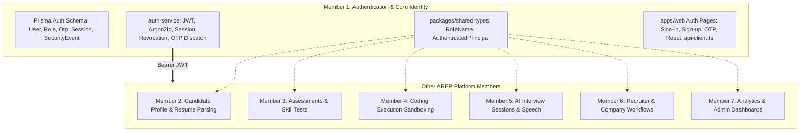

# AREP Member 1: Authentication & Core Identity Final Implementation Handoff

This document defines the final ownership boundaries, stable interfaces, integration conventions, and operational handoff details for AREP Member 1's Authentication and Identity foundation.

---

## 1. Delivered Scope

Member 1 has delivered the complete authentication, identity, and shared security foundation for the AREP platform:

### Backend Microservice (`services/auth-service`)
- **Core Identity & Credentials**: User registration with Argon2id password hashing (memoryCost: 65536 KiB, timeCost: 3, parallelism: 4) meeting OWASP guidelines.
- **Two-Step Login Flow**: Step 1 validates email/password; Step 2 gates on a 6-digit cryptographic email OTP challenge.
- **Email Verification**: Independent 6-digit numeric OTP challenge using HMAC-SHA256 verifiers.
- **Session & Token Management**:
  - JWT access tokens (HMAC-SHA256, 15-minute default TTL, explicit `iss` and `aud`).
  - Refresh tokens managed as single-use rotating tokens in PostgreSQL and HttpOnly cookies.
  - Native client support (`X-Client-Type: native`) providing tokens via JSON without cookies.
  - Refresh token rotation with atomic Compare-And-Swap (CAS) and replay attack detection (immediately revoking all user sessions upon token reuse).
  - Session revocation on logout, password change, account suspension, or security compromise.
- **Password Governance**:
  - Strict password policy (min 12 chars, upper, lower, digit, special symbol).
  - 5-entry password history reuse prevention.
- **Role-Based Access Control (RBAC)**:
  - Canonical roles: `CANDIDATE`, `RECRUITER`, `COMPANY_HR`, `MODERATOR`, `ADMIN`, `SUPER_ADMIN`.
  - NestJS `@Roles(...)` and `@AllowAnyRole()` route guards with strict fail-closed defaults.
- **Defense in Depth**:
  - Anti-enumeration & timing attack mitigations (identical response status and shape for existing vs non-existent accounts).
  - CSRF origin and referer verification on cookie-bearing routes (`/auth/refresh`, `/auth/logout`).
  - Multi-tiered rate limiting with IP isolation behind trusted proxies (`TRUST_PROXY`).
  - Append-only `SecurityEvent` audit logging with zero sensitive data in metadata.
- **Operational Probes & Configuration Validation**:
  - Liveness probe (`GET /health`) and dependency-aware readiness probe (`GET /ready`).
  - Non-destructive configuration validation CLI (`pnpm auth:validate-config`).

### Shared Types Package (`packages/shared-types`)
- Canonical role enum: `RoleName` (`CANDIDATE`, `RECRUITER`, `COMPANY_HR`, `MODERATOR`, `ADMIN`, `SUPER_ADMIN`).
- Array `CANONICAL_ROLES` and type guard `isRoleName()`.
- Verified principal contract: `AuthenticatedPrincipal` (`id`, `email`, `roles`, `sessionId`, `authVerified`).
- Request contract: `AuthenticatedRequest` (`user?: AuthenticatedPrincipal`).

### Web Frontend Integration (`apps/web`)
- Typed API client (`apps/web/src/lib/api-client.ts`) adhering strictly to security contracts:
  - Access tokens stored strictly in JavaScript memory (never in localStorage or document cookies).
  - Refresh tokens exchanged exclusively through browser HttpOnly cookies.
  - Automatic refresh loop prevention.
  - Safe request retry policy (GET/HEAD replayed automatically after refresh; unsafe POST/PUT not retried).
  - Standardized error parsing into `ApiError` without leaking raw server stack traces.
- Complete responsive frontend authentication flows: Sign-up, email verification, sign-in, login OTP, forgot password, and reset password.

---

## 2. Stable Public API Contracts for Other AREP Modules

Other AREP modules and services can rely on the following stable contracts exposed by `auth-service`:

### Authentication Endpoints

| Method | Endpoint | Auth Required | Request Body / Headers | Response Payload (Success) | Key HTTP Error Codes |
| :--- | :--- | :--- | :--- | :--- | :--- |
| `POST` | `/auth/register` | No | `RegisterDto` (fullName, email, password, passwordConfirmation, termsAccepted) | `HTTP 201 Created`<br>`{ id, email, fullName, mobileNumber, accountStatus, emailVerified, createdAt }` | 400 (Validation), 409 (Email exists), 429 (Rate limit) |
| `POST` | `/auth/verify-email` | No | `VerifyEmailDto` (email, code) | `HTTP 200 OK`<br>`{ success: true, message: "Email verified successfully." }` | 400 (Invalid/expired OTP), 429 |
| `POST` | `/auth/login` | No | `LoginDto` (email, password) | `HTTP 200 OK`<br>`{ requiresOtp: true, email: string }` | 401 (Invalid credentials / Suspended), 429 |
| `POST` | `/auth/verify-login-otp` | No | `VerifyLoginOtpDto` (email, code)<br>Optional: `X-Client-Type: native` | `HTTP 200 OK`<br>`{ accessToken, tokenType: "Bearer", expiresIn: 900, user: { id, email, roles, emailVerified, accountStatus } }`<br>*Browser sets HttpOnly `refreshToken` cookie* | 400 (Invalid/expired OTP), 401 (Suspended), 429 |
| `POST` | `/auth/refresh` | Cookie or Body | Browser: HttpOnly cookie<br>Native: `RefreshTokenDto` (refreshToken) | `HTTP 200 OK`<br>`{ accessToken, tokenType: "Bearer", expiresIn: 900, user: { ... } }`<br>*Browser sets rotated HttpOnly cookie* | 401 (Invalid/reused token), 403 (CSRF untrusted origin), 429 |
| `POST` | `/auth/logout` | Cookie or Body | Browser: HttpOnly cookie<br>Native: `LogoutDto` (refreshToken) | `HTTP 200 OK`<br>`{ success: true, message: "Successfully logged out." }`<br>*Browser clears HttpOnly cookie* | 403 (CSRF untrusted origin) |
| `POST` | `/auth/forgot-password` | No | `ForgotPasswordDto` (email) | `HTTP 200 OK`<br>`{ success: true, message: "If that email exists in our system, a password reset code has been sent." }` | 400 (Validation), 429 |
| `POST` | `/auth/reset-password` | No | `ResetPasswordDto` (email, code, password, passwordConfirmation) | `HTTP 200 OK`<br>`{ success: true, message: "Password reset successfully. Please log in with your new password." }` | 400 (Invalid OTP / Password reuse / Weak password), 429 |
| `GET` | `/health` | No | None | `HTTP 200 OK`<br>`{ status: "ok", service: "auth-service" }` | None |
| `GET` | `/ready` | No | None | `HTTP 200 OK`<br>`{ status: "ready", service: "auth-service", checks: { process: "up", database: "up", redis: "up" } }` | 503 (Dependency degraded) |

### Authenticated Request Principal Interface
When downstream services inspect incoming requests bearing a Bearer access token:
```typescript
import { AuthenticatedPrincipal } from '@repo/shared-types';

// Attached to req.user by AccessTokenGuard
interface AuthenticatedPrincipal {
  id: string;          // User UUID
  email: string;       // User email address
  roles: RoleName[];   // Verified canonical roles (e.g. ['CANDIDATE'])
  sessionId?: string;  // Active session UUID
  authVerified?: boolean; // Cryptographic verification flag
}
```

---

## 3. Ownership Boundaries



### Member 1 Ownership (Do NOT Modify Without Coordination)
- Core identity storage: `User`, `ExternalIdentity`, `Role`, `UserRole`, `OtpChallenge`, `AuthSession`, `PasswordHistory`, `SecurityEvent`.
- Database schema and migrations: `services/auth-service/prisma/schema.prisma` and baseline migration `20261011171906_init_auth_schema`.
- Cryptographic primitives: Argon2id password hashing, HMAC-SHA256 OTP verification, JWT access token issuance/verification.
- Distributed session revocation registry: Redis keys `auth:revoked:user:<userId>` and `auth:revoked:session:<sessionId>`.
- Authentication routing & cookies: `/auth/*` endpoints and HttpOnly cookie lifecycle.
- Shared identity types: `@repo/shared-types`.
- Frontend authentication views: `apps/web/src/app/(sign-in|sign-up|verify-email|forgot-password|reset-password)` and `apps/web/src/lib/api-client.ts`.

### Other Members' Ownership (Member 1 Does NOT Own)
- **Candidate Domain (Member 2)**: Candidate profiles, resumes, work history, skills taxonomy, and resume file storage. Must reference `User` strictly via `userId UUID` foreign key without adding profile fields to `users`.
- **Assessment Domain (Member 3)**: Question banks, assessment attempts, proctoring rules, and scorecards. Must consume `req.user.id` and require `CANDIDATE` role.
- **Code Execution Domain (Member 4)**: Sandboxed code runner, test cases, and execution limits. Must authenticate via Bearer JWT.
- **AI Interview Domain (Member 5)**: Audio/video capture, LLM interview orchestration, feedback summaries.
- **Recruiter & Employer Domain (Member 6)**: Job postings, ATS pipelines, company profiles, recruiter invitations. Must require `RECRUITER` or `COMPANY_HR` roles.
- **Platform Analytics & Admin (Member 7)**: Platform reporting, system auditing, tenant moderation. Must require `ADMIN` or `SUPER_ADMIN` roles.

### Boundary Protection Audit Check
- **No Duplicate Authentication**: No other module or package implements token generation, password hashing, or OTP storage.
- **No Unintentional Overreach**: `auth-service` contains **zero** candidate profile fields, zero assessment schemas, zero recruiter workflows, and zero billing logic. The Prisma schema is strictly confined to authentication tables.

---

## 4. Integration Dependencies for Other Members

Other members developing services or frontend pages must adhere to these conventions:

### A. Canonical Role Names
Always import roles from `@repo/shared-types`. Never hardcode role strings.
```typescript
import { RoleName } from '@repo/shared-types';

// Correct:
if (user.roles.includes(RoleName.CANDIDATE)) { ... }

// Prohibited:
if (user.roles.includes('candidate')) { ... } // INCONSISTENT CASE
```

### B. Route Protection in Downstream Services
To protect routes in downstream NestJS or Express services:
1. Extract Bearer token from `Authorization: Bearer <token>`.
2. Verify token signature with `JWT_SECRET`, matching `iss === 'arep-auth-service'` and `aud === 'arep-api'`.
3. Check token expiration (`exp`).
4. Attach `AuthenticatedPrincipal` to `req.user`.
5. Enforce role guards: reject if required role is missing (HTTP 403 Forbidden).

### C. Frontend API Integration
In frontend components:
```typescript
import { apiClient } from '@/lib/api-client';

// Making an authenticated API call with automatic memory-token attachment:
const response = await apiClient.fetchWithAuth('/api/v1/assessments/my-tests', {
  method: 'GET',
});
```

### D. Standardized Error Format
All services must return errors matching the standard NestJS / RFC 7807 structure:
```json
{
  "statusCode": 403,
  "message": "Insufficient role permissions for this resource.",
  "error": "Forbidden"
}
```
Frontends parsing through `apiClient` automatically receive an `ApiError` instance with `statusCode` and `details: string[]`.

---

## 5. Verified Redis Outage Contract

A dedicated audit of the code (`TokenService.isTokenRevoked`) and test suite (`concurrency-transaction-consistency.spec.ts`, `distributed-revocation-cache.spec.ts`) verified the exact status-code contract during Redis outages:

- **Behavior**: When Redis is enabled but unreachable (disconnected socket, timeout, or cluster down) during a token revocation lookup:
  - `TokenService.isTokenRevoked()` intentionally **fails closed** to prevent unauthorized access.
  - It throws `ServiceUnavailableException('Authentication revocation registry is unavailable. Protected requests cannot be verified.')`.
  - At the HTTP boundary, NestJS produces **HTTP 503 Service Unavailable**.
- **Important Distinction**:
  - It does **NOT** return `HTTP 401 Unauthorized`.
  - `HTTP 401` is reserved strictly for invalid credentials, expired tokens, or confirmed revoked sessions.
  - Returning `HTTP 503` ensures API gateways, load balancers, and clients correctly recognize an infrastructure outage (triggering health retries or failover) rather than falsely concluding that the user's credentials are invalid.

---

## 6. Known Limitations & Architectural Notes

1. **Symmetric JWT Signing (`HS256`)**:
   - The current access token implementation uses single-key HMAC-SHA256.
   - Key rotation immediately invalidates active access tokens; browser users experience no disruption as the HttpOnly cookie silently refreshes on their next request.
   - *Future Roadmap*: Asymmetric RS256/EdDSA with JWKS endpoint (`/.well-known/jwks.json`) can be introduced for zero-downtime key rotation across independent microservices.
2. **Reverse Proxy Dependency**:
   - Rate limiting and audit logging depend on `X-Forwarded-For` when `TRUST_PROXY=true`.
   - Ingress/load-balancer configurations **must** sanitize incoming headers to prevent client IP spoofing.
3. **Database Dependency**:
   - In production (`NODE_ENV=production`), `DATABASE_ENABLED=true` and `REDIS_ENABLED=true` are strictly enforced. Ephemeral in-memory mock mode is completely disabled.

---

## 7. Verification Summary & Test Evidence

All verification in this handoff was performed strictly offline:

| Verification Suite / Tool | Command | Scope | Result |
| :--- | :--- | :--- | :--- |
| **Auth Service Tests** | `pnpm --filter auth-service test` | 24 test files across auth, token, session, OTP, email, rate-limit, and concurrency | **439 / 439 passed (0 failures)** |
| **Web Frontend Tests** | `pnpm --filter web test` | 11 test suites across API client, token handling, cookie contracts, and error parsing | **26 / 26 passed (0 failures)** |
| **Strict Typecheck** | `pnpm typecheck` | Monorepo typecheck across 5 workspace projects | **Passed (0 type errors)** |
| **Production Build** | `pnpm --filter auth-service build` | TypeScript compilation to `dist/` | **Passed (Exit code 0)** |
| **Config Validator** | `pnpm auth:validate-config` | Offline pre-flight validator | **Passed (Exit code 0, 0 sockets opened)** |
| **Template Guard Check** | `validate-env.js .env.production.example` | Template placeholder rejection | **Passed (Exit code 1, correctly caught 8 placeholders)** |

### Explicit Staging Prerequisites (NOT Tested Live)
In accordance with safety guidelines, the following have **not** been tested live and require live staging infrastructure:
- Applying Prisma migrations to a dedicated staging PostgreSQL RDS instance.
- Distributed Redis cluster multi-instance replication and latency.
- Real SMTP email delivery to external mailboxes (tested via unit mocks only).
- Live browser cross-subdomain cookie exchange behind a TLS-terminating reverse proxy.

---

## 8. Integration Checklist for the Next AREP Member

When building a new module (e.g. Member 2 Candidate Profiles or Member 3 Assessments):

- [ ] **Package Reference**: Add `@repo/shared-types: "workspace:*"` to your service or app `package.json`.
- [ ] **Import Roles**: Use `RoleName` from `@repo/shared-types` for any role authorization checks.
- [ ] **Foreign Key Modeling**: In your database schemas, reference users via `userId: String @db.Uuid` pointing to `User.id`. Do not create a duplicate user table.
- [ ] **Guard Requests**: Protect endpoints using an access token guard that validates the Bearer JWT and sets `req.user: AuthenticatedPrincipal`.
- [ ] **Frontend Client**: Use `apiClient.fetchWithAuth()` from `@/lib/api-client` in `apps/web` to automatically forward the in-memory access token.
- [ ] **Error Handling**: Return `{ statusCode, message, error }` JSON format for consistent frontend error parsing.
- [ ] **Configuration**: Keep authentication configuration (`JWT_SECRET`, `DATABASE_URL`) managed in the root `.env` or Secret Manager; do not hardcode secrets.
